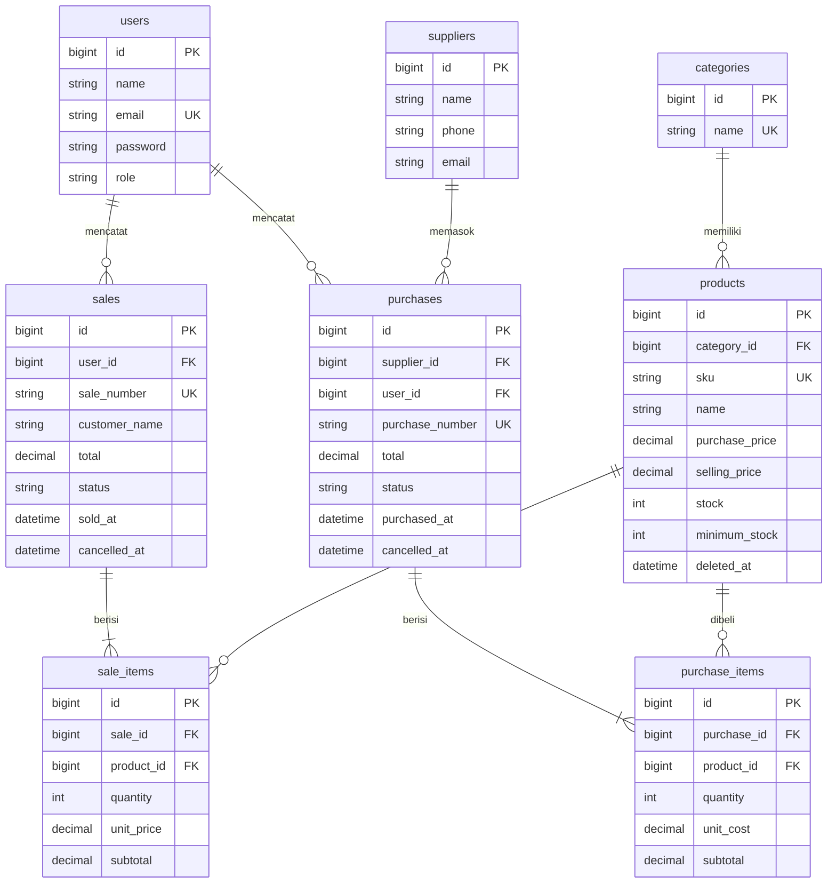

# Toko Tumbler - Inventory & Sales Management System

Proyek UTS **Web Programming 2** (Integrated Laravel Project).
Aplikasi web untuk mengelola produk tumbler, pemasok, pembelian stok (stock-in), dan penjualan,
dengan stok yang selalu konsisten dengan transaksi.

---

## 1. Project Overview

Sebuah toko tumbler kecil mengelola produk, pemasok, pembelian stok, dan penjualan melalui beberapa staf.
Pencatatan manual membuat stok tidak sesuai transaksi, barang habis masih bisa terjual, dan riwayat sulit ditelusuri.
Aplikasi ini menyelesaikan masalah tersebut:

- Stok **berubah otomatis** saat pembelian atau penjualan berhasil.
- Penjualan **ditolak** bila stok tidak cukup (tanpa mengubah data apa pun).
- Dua role dengan hak akses berbeda: **Admin/Owner** dan **Staff**, dijaga di sisi **server**.
- Dashboard ringkas yang dihitung dari database.

Teknologi: Laravel (MVC), MySQL, Eloquent ORM, Blade, Bootstrap 5 (CDN), PHPUnit.

## 2. Requirements

| Kebutuhan | Versi |
|---|---|
| PHP | 8.2 atau lebih baru (ekstensi: `pdo_mysql`, `pdo_sqlite` untuk test, `mbstring`, `openssl`, `tokenizer`, `xml`, `ctype`, `json`) |
| Composer | 2.x |
| MySQL / MariaDB | 8.x / 10.x |
| Node.js | **Tidak diperlukan** (CSS/JS memakai CDN, tidak ada build step) |

## 3. Installation

Folder ini berisi **kode aplikasi saja** (migration, model, controller, view, test, dst.).
Framework Laravel dipasang lewat Composer, lalu kode ini disalin ke atasnya.

```bash
# 1. Buat project Laravel baru
composer create-project laravel/laravel tumbler-store
cd tumbler-store

# 2. Salin kode aplikasi (dari folder tumbler-store-overlay) ke project Laravel
#    macOS / Linux / Git Bash:
../tumbler-store-overlay/install.sh .
#    Windows (manual): salin folder app, database, resources, routes, tests
#    dari tumbler-store-overlay ke folder tumbler-store, pilih "Replace/Timpa file yang sama".
```

Jika project ini diunggah ke GitHub, urutan untuk dosen/orang lain adalah:

```bash
git clone <repository-url>
cd tumbler-store
composer install
cp .env.example .env
php artisan key:generate
# atur DB di .env (bagian 4)
php artisan migrate --seed
php artisan serve
```

> Catatan: karena tampilan memakai Bootstrap dari CDN, **tidak perlu** `npm install` / `npm run build`.
> Komputer perlu terhubung internet saat membuka aplikasi agar tampilan termuat.

## 4. Environment Setup

Buat database kosong di MySQL, misalnya `tumbler_store`:

```sql
CREATE DATABASE tumbler_store CHARACTER SET utf8mb4 COLLATE utf8mb4_unicode_ci;
```

Lalu ubah bagian berikut di file `.env` (hanya file `.env.example` yang boleh di-commit, jangan commit `.env`):

```dotenv
APP_NAME="Toko Tumbler"
APP_LOCALE=id
APP_TIMEZONE=Asia/Jakarta        # tambahkan baris ini jika belum ada (atau ubah config/app.php)

DB_CONNECTION=mysql
DB_HOST=127.0.0.1
DB_PORT=3306
DB_DATABASE=tumbler_store
DB_USERNAME=root
DB_PASSWORD=
```

Pada Laravel terbaru, `.env` bawaan memakai SQLite; ubah `DB_CONNECTION` menjadi `mysql` seperti di atas.

## 5. Migration & Seeding

```bash
php artisan migrate --seed
# atau mengulang dari nol:
php artisan migrate:fresh --seed
```

Seeder menyiapkan: 2 akun demo, 5 kategori, 3 pemasok, dan 15 produk (4 di antaranya sengaja stok rendah
agar halaman *Stok Rendah* dan dashboard langsung ada isinya). Seeder **tidak** membuat transaksi;
buat lewat menu Pembelian / Penjualan.

Jalankan server: `php artisan serve` lalu buka <http://127.0.0.1:8000>.

## 6. Demo Account

| Role | Email | Password |
|---|---|---|
| Admin / Owner | `admin@tumbler.test` | `password123` |
| Staff | `staff@tumbler.test` | `password123` |

Akun ini hanya data demo, bukan kredensial asli. Password disimpan dalam bentuk hash.

## 7. Features

| Modul | Admin | Staff |
|---|:---:|:---:|
| Login / logout, route terlindungi (`auth`) | ✅ | ✅ |
| Dashboard (total produk, penjualan hari ini/bulan ini, jumlah transaksi, stok rendah) | ✅ semua data | ✅ transaksi miliknya |
| Lihat daftar & detail produk, cari SKU/nama, filter kategori, pagination | ✅ | ✅ |
| Daftar stok rendah | ✅ | ✅ |
| CRUD Produk | ✅ | ❌ |
| CRUD Kategori | ✅ | ❌ |
| CRUD Pemasok | ✅ | ❌ |
| Manajemen user & role | ✅ | ❌ |
| Pembelian / stock-in (banyak item per transaksi) | ✅ semua | ✅ miliknya |
| Penjualan (banyak item per transaksi) | ✅ semua | ✅ miliknya |
| Batalkan transaksi (stok dipulihkan konsisten) | ✅ | ❌ |
| Filter transaksi: nomor, status, rentang tanggal + pagination | ✅ | ✅ |

### Business rules dan lokasinya di kode

| Aturan | Implementasi |
|---|---|
| SKU unik | `ProductRequest` (`Rule::unique`) **dan** unique index di migration `create_products_table` |
| Harga & kuantitas valid, qty > 0 | `ProductRequest`, `StoreSaleRequest`, `StorePurchaseRequest`; kolom `unsigned` di database |
| Penjualan tidak boleh melebihi stok | `SaleService::create()` memeriksa `stock < qty` sebelum `decrement` |
| Stok berubah hanya setelah transaksi sukses | Semua perubahan stok ada di dalam `DB::transaction` di `SaleService` / `PurchaseService`; `stock` tidak ada di `$fillable` |
| Total dihitung server | Request tidak menerima `total`/`price`; service membaca `selling_price` dari database |
| Header + detail + stok dalam satu transaction | `DB::transaction(...)` di service; error di tengah proses = rollback |
| Cegah overselling pada transaksi bersamaan | `Product::lockForUpdate()` di dalam transaction |
| Item produk sama di banyak baris digabung | `SaleService::mergeItems()` |
| Transaksi selesai tidak diedit; ada aturan pembatalan | Tidak ada route edit; `cancel()` memulihkan stok dan menolak pembatalan ganda |
| Produk terpakai transaksi tidak di-hard delete | `ProductController::destroy()` menolak, selain itu `SoftDeletes` |
| Authorization di server | `Gate::define` di `AppServiceProvider` + middleware `can:` di `routes/web.php` + `Gate::authorize('view-transaction')` |
| CSRF, escaping, hashing | `@csrf` di semua form, `{{ }}` Blade, cast `hashed` di model `User` |

## ERD



### Relasi Eloquent

| Model | Relasi |
|---|---|
| `Category` | `hasMany(Product)` |
| `Product` | `belongsTo(Category)`, `hasMany(SaleItem)`, `hasMany(PurchaseItem)` |
| `Supplier` | `hasMany(Purchase)` |
| `Purchase` | `belongsTo(Supplier)`, `belongsTo(User)`, `hasMany(PurchaseItem)` |
| `PurchaseItem` | `belongsTo(Purchase)`, `belongsTo(Product)` |
| `Sale` | `belongsTo(User)`, `hasMany(SaleItem)` |
| `SaleItem` | `belongsTo(Sale)`, `belongsTo(Product)` |
| `User` | `hasMany(Sale)`, `hasMany(Purchase)` |

**hasMany vs belongsTo:** `hasMany` dipakai di sisi "satu" (satu `Sale` punya banyak `SaleItem`);
`belongsTo` dipakai di sisi "banyak" yang menyimpan foreign key (`SaleItem` milik satu `Sale`).
Foreign key berada di tabel detail karena satu kolom hanya bisa menyimpan satu nilai: satu item hanya milik satu
penjualan, tetapi satu penjualan punya banyak item, sehingga tidak mungkin menyimpan banyak id item di kolom tabel header.

N+1 dihindari dengan eager loading, mis. `Product::with('category')->paginate(10)`.

## Arsitektur

```
Browser -> routes/web.php -> Middleware (auth, can:) -> Controller
        -> Form Request (validasi) -> Service (business logic + DB::transaction)
        -> Eloquent Model -> MySQL -> Blade view
```

- `app/Http/Controllers` : menerima request, memanggil service, mengembalikan view/redirect
- `app/Http/Requests`    : validasi server-side + pesan error berbahasa Indonesia
- `app/Services`         : `SaleService`, `PurchaseService` (transaksi, kunci baris, rollback)
- `app/Models`           : relasi, scope (`search`, `lowStock`, `filter`, `visibleTo`), mass-assignment protection
- `resources/views`      : layout reusable `layouts/app.blade.php`, pesan sukses/error, pagination

## Testing

```bash
php artisan test
```

Test memakai SQLite in-memory (ekstensi `pdo_sqlite` harus aktif) sehingga tidak menyentuh database MySQL.

| Skenario (brief UTS) | Test |
|---|---|
| Guest tidak bisa buka dashboard | `AuthTest::test_guest_cannot_open_dashboard` |
| Password salah ditolak | `AuthTest::test_wrong_password_is_rejected` |
| SKU duplikat ditolak | `ProductTest::test_duplicate_sku_is_rejected` |
| Harga negatif ditolak | `ProductTest::test_negative_price_is_rejected` |
| Pembelian menambah stok | `PurchaseTest::test_purchase_increases_stock_by_quantity` |
| Penjualan mengurangi stok | `SaleTest::test_sale_reduces_stock_and_server_calculates_total` |
| Stok tidak cukup ditolak tanpa perubahan data | `SaleTest::test_sale_with_insufficient_stock_is_rejected_without_any_change` |
| Satu item gagal = rollback semua | `SaleTest::test_failure_on_one_item_rolls_back_the_whole_transaction` |
| Staff tidak bisa akses fungsi Admin | `AuthorizationTest` (beberapa test) |
| Filter & pagination sesuai | `SearchAndDashboardTest` |
| Total/harga dari browser diabaikan | `SaleTest::test_total_and_price_from_browser_are_ignored` |
| Pembatalan memulihkan stok, tidak bisa dobel | `SaleTest::test_admin_cancel_restores_stock_and_cannot_cancel_twice` |

Lampirkan hasil `php artisan test` (screenshot terminal) di laporan sebagai bukti pengujian.

## 8. Known Limitations

- Tidak ada payment gateway, multi-gudang, akuntansi penuh, multi-currency, atau integrasi ERP (di luar ruang lingkup UTS).
- Edit transaksi yang sudah selesai tidak disediakan; koreksi dilakukan dengan membatalkan lalu membuat transaksi baru.
- Pembatalan pembelian ditolak jika sebagian barang sudah terjual (stok tidak boleh negatif).
- Reset password / registrasi mandiri tidak ada; akun dibuat oleh Admin.
- Tampilan memerlukan internet karena Bootstrap dimuat dari CDN.
- Pembatalan dan perubahan harga produk tidak memiliki audit log terpisah.

## Catatan untuk Demo / Code Ownership Interview

Pelajari alur ini sampai bisa menjelaskannya tanpa melihat kode:

1. **Di mana stok dijaga agar tidak negatif?** `SaleService::create()` (cek `$product->stock < $qty`) dan kolom `unsigned` di database sebagai pengaman terakhir.
2. **Mengapa total dihitung di server?** Input browser bisa dimanipulasi; harga diambil dari tabel `products`, lihat `test_total_and_price_from_browser_are_ignored`.
3. **Risiko pengurangan stok di luar `DB::transaction`?** Jika langkah berikutnya gagal, header/detail bisa setengah tersimpan atau stok sudah berkurang tanpa transaksi.
4. **Staff mengetik URL admin langsung?** Route dibungkus `can:manage-master` / `can:manage-users`, hasilnya 403 walau tombol disembunyikan.
5. **Dua penjualan bersamaan pada produk yang sama?** `lockForUpdate()` membuat transaksi kedua menunggu sampai yang pertama commit, lalu membaca stok terbaru.
6. **SKU unik?** Validasi `Rule::unique` (pesan ramah pengguna) + unique index database (jaminan akhir saat dua request berbarengan).
7. **Ubah aturan stok minimum?** Lihat `Product::isLowStock()` dan `Product::scopeLowStock()`.

> Gunakan proyek ini sebagai bahan belajar. Dosen dapat meminta Anda menjelaskan dan mengubah kode secara langsung,
> jadi pastikan Anda memahami setiap bagian, dan ikuti aturan mata kuliah mengenai penggunaan alat bantu AI/atribusi.

